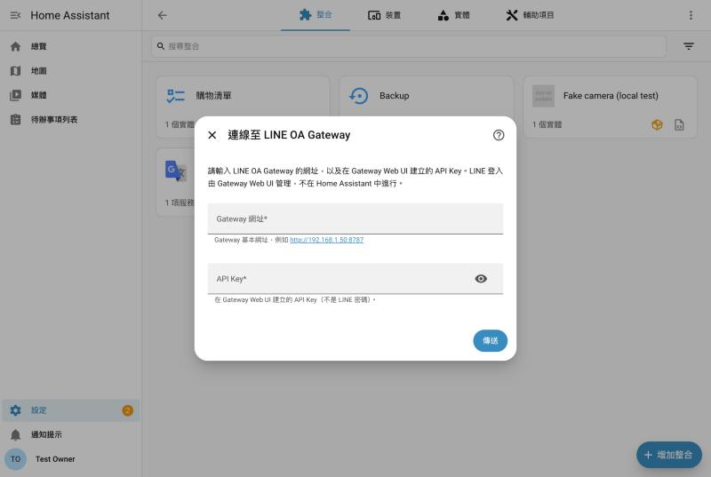
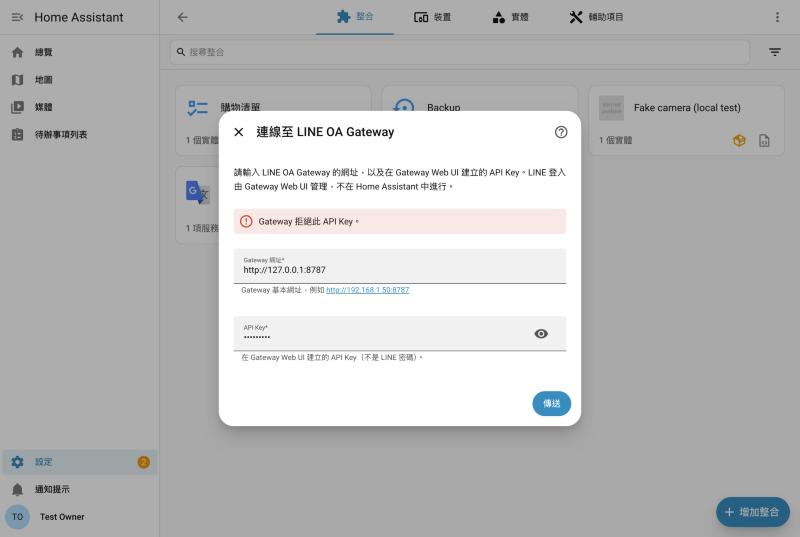
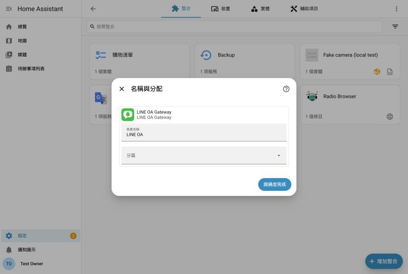
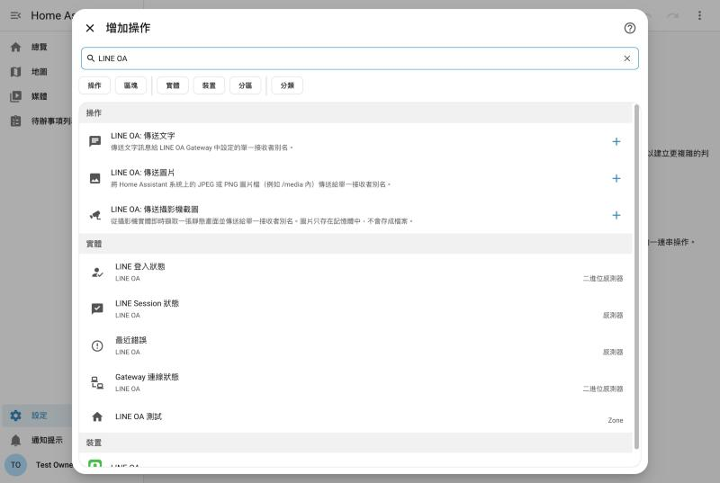

# LINE OA for Home Assistant

[](https://hacs.xyz/docs/faq/custom_repositories/)
[](https://github.com/xangin/line-oa-hacs/releases)
[](https://github.com/xangin/line-oa-hacs/actions/workflows/validate.yml)
[](https://github.com/xangin/line-oa-hacs/actions/workflows/tests.yml)

讓 Home Assistant 透過 LINE 官方帳號發送**文字、圖片與攝影機截圖**通知。

本儲存庫是 **Home Assistant 整合（HACS）**，負責提供動作與狀態實體；實際登入 LINE、發送訊息的是 **LINE OA Gateway**。建議搭配 Add-on 使用：

| 元件 | 儲存庫 | 用途 |
| --- | --- | --- |
| **LINE OA 整合**（本儲存庫） | `https://github.com/xangin/line-oa-hacs` | `line_oa.*` 動作、四個狀態實體、自動探索與安全配對 |
| **LINE OA Add-on**（建議） | [`https://github.com/xangin/line-oa-ha-addon`](https://github.com/xangin/line-oa-ha-addon) | LINE 登入、收件者別名、發送 Gateway（Ingress 管理介面） |

> **非官方 LINE 專案。** Gateway 使用 LINE 官方帳號管理後台的未公開聊天介面，並非 LINE Messaging API，也未獲 LINE 背書。LINE 服務變更或登入限制可能影響使用；請遵守 LINE 使用規範，不適合大量群發或必須保證送達的緊急通知。

同一份整合同時支援兩種 Gateway，使用相同的動作、實體與自動化：

| 連線方式 | Gateway 在哪裡 | 設定時要輸入 |
| --- | --- | --- |
| **Home Assistant Add-on**（建議） | HA 內的 [LINE OA Add-on](https://github.com/xangin/line-oa-ha-addon) | **不用輸入**：HA 自動發現 → 按確認 → 安全自動配對 |
| **外部 Gateway** | Ubuntu LXC / Docker / Linux | Gateway 網址 + API Key |

```
                         ┌─ Add-on 模式：Supervisor 探索 + 一次性配對 ─▶ LINE OA Add-on（HA 內）─┐
Home Assistant ─ LINE OA ┤                                                                     ├─▶ LINE 官方帳號
                         └─ 外部模式：網址 + API Key ──────────────────▶ LINE OA Gateway（LXC）──┘
```

提供：

| 類型 | 名稱 |
| --- | --- |
| Action | `line_oa.send_text`、`line_oa.send_image`、`line_oa.send_screen_shot` |
| 狀態實體 | `binary_sensor.line_oa_connected`、`binary_sensor.line_oa_logged_in`、`sensor.line_oa_session_status`、`sensor.line_oa_last_error` |

> 本整合刻意**不**建立 `notify.line_oa`，也不會依聯絡人建立任何實體。

---

## 需求

| 項目 | 需求 |
| --- | --- |
| Home Assistant | **2026.9.0** 以上（已用 2026.9.0、2026.9.2、2026.10.1 測試） |
| HACS | 2.x |
| 使用 Add-on 時 | 有 Supervisor 的安裝（建議 **Home Assistant OS**）；Add-on 目前僅提供 **amd64（x86-64）** 映像 |
| LINE | 可管理該官方帳號的 LINE 帳號，且官方帳號已啟用「聊天」（見 [Add-on 說明](https://github.com/xangin/line-oa-ha-addon#2-必須啟用聊天並建立對話)） |

HA Container / Core（沒有 Supervisor）無法安裝 Add-on，請改用外部 Gateway。

---

## 快速安裝（搭配 Add-on，建議）

### 步驟 1：安裝 LINE OA Add-on

[](https://my.home-assistant.io/redirect/supervisor_add_addon_repository/?repository_url=https%3A%2F%2Fgithub.com%2Fxangin%2Fline-oa-ha-addon)

或手動：

1. **設定 → 應用程式／附加元件 → 商店**（名稱依 HA 版本而不同）→ 右上角 ⋮ → **儲存庫（Repositories）**，加入：

   ```text
   https://github.com/xangin/line-oa-ha-addon
   ```

2. 找到 **LINE OA** → **安裝** → **啟動**（建議開啟「開機啟動」）。
3. 按 **開啟 Web UI**：用手機 LINE 掃描登入官方帳號，再到「聯絡人」為收件者設定**別名**（例如 `home`；小寫英數、底線或連字號，1–32 字元）。

詳細步驟見 [Add-on 說明文件](https://github.com/xangin/line-oa-ha-addon#readme)。

### 步驟 2：用 HACS 安裝本整合

[](https://my.home-assistant.io/redirect/hacs_repository/?owner=xangin&repository=line-oa-hacs&category=integration)

或手動：

1. 開啟 **HACS** → 右上角 ⋮ → **自訂儲存庫（Custom repositories）**。
2. Repository 填入下列網址，類別選 **Integration**（整合），按「新增」：

   ```text
   https://github.com/xangin/line-oa-hacs
   ```

3. 在 HACS 搜尋 **LINE OA** → **下載**。
4. **重新啟動 Home Assistant**（設定 → 系統 → 右上角電源 → 重新啟動）。

### 步驟 3：確認自動探索並配對

1. 重新啟動後，**設定 → 裝置與服務** 會出現「**已發現：LINE OA**」，點 **新增／設定**。
2. 畫面詢問「是否將 LINE OA Add-on 連接到 Home Assistant？」→ **提交**。
3. HA 會與 Add-on 安全配對並自動取得專用 API Key，完成後建立四個狀態實體，三個動作即可使用。

全程**不需要輸入 IP、埠或 API Key**，也不會發送任何 LINE 訊息。沒有看到「已發現」時，可以手動：

[](https://my.home-assistant.io/redirect/config_flow_start/?domain=line_oa)

→ 選 **Home Assistant Add-on**。詳見 [docs/addon-connection.md](docs/addon-connection.md)。

### 步驟 4：測試

在 **開發者工具 → 動作** 執行（`who` 填 Add-on 裡設定的別名）：

```yaml
action: line_oa.send_text
data:
  who: home
  message: "LINE OA 測試通知"
```

---

## 手動安裝（不使用 HACS）

下載 [最新版本](https://github.com/xangin/line-oa-hacs/releases/latest)，把 `custom_components/line_oa/` 整個資料夾複製到 HA 的 `/config/custom_components/line_oa/`，然後重新啟動 Home Assistant。

---

## 設定（圖形化，不需要修改 `configuration.yaml`）

### 方式 A：Home Assistant Add-on（自動配對）

即上方「快速安裝」的步驟 3。不需要輸入 IP、埠、API Key、LINE Cookie、Bot ID 或 Chat ID。詳見 [docs/addon-connection.md](docs/addon-connection.md)。

也可以手動：**新增整合 → LINE OA → Home Assistant Add-on**（找不到 Add-on 時會顯示安裝指引，不會假裝已找到）。

### 方式 B：外部 Gateway（LXC / Docker / Linux）

1. 在 Gateway Web UI 完成 LINE 登入、設定別名，並**建立 API Key**。
2. **設定 → 裝置與服務 → 新增整合 → LINE OA → 外部 Gateway**。
3. 輸入 **Gateway 網址**（例如 `http://192.168.1.50:8790`）與 **API Key**。
4. 整合會依序：檢查 `GET /api/v1/health` → 以 API Key 呼叫 `GET /api/v1/status` → 檢查 API 版本 → 讀取 `instance_id` → 建立設定。

舊版 LXC Gateway 沒有回報 `api_version` 時視為 v1，可直接使用，不需要先升級。詳見 [docs/external-connection.md](docs/external-connection.md)。

### 詳細文件

- [Add-on 自動探索與配對](docs/addon-connection.md)
- [外部 Gateway（LXC）手動連線](docs/external-connection.md)
- [LXC 切換至 Add-on](docs/migration.md)
- [安全性：API Key、Discovery、配對](docs/security.md)
- [錯誤排除](docs/troubleshooting.md)

### 兩種認證要分清楚

| 認證 | 用途 | 失效時怎麼處理 |
| --- | --- | --- |
| Gateway API Key | Home Assistant ↔ Gateway | Add-on：在 Add-on 按「允許 Home Assistant 配對」後由 HA 重新配對；外部：輸入新的 API Key |
| LINE Session | Gateway ↔ LINE | 在 **Gateway / Add-on 的 Web UI** 重新登入 LINE；HA 不需要改任何設定 |

說明：

- Gateway 可連線但 LINE Session 已過期時，**仍可完成設定**，LINE 登入問題會顯示在狀態實體上。
- 以 Gateway 的 `instance_id` 作為唯一識別，**不是 IP**。
- 一次只連接**一台** Gateway（三個動作沒有 Gateway 選擇欄位）。已連接 LXC 又安裝 Add-on 時，HA 會詢問「保留目前連線」或「遷移至 Add-on」，**不會自動切換**，見 [docs/migration.md](docs/migration.md)。

畫面（HA 2026.10.1 + Mock Gateway 實機截圖，外部 Gateway 早期版本的表單）：

| 設定表單 | API Key 錯誤 | 設定完成 |
| --- | --- | --- |
|  |  |  |

| 自動化編輯器中的三個 Action |
| --- |
|  |

### 外部 Gateway 的自動發現（免輸入網址）

HA 只會在下列兩種情況自動帶出 Gateway 網址，使用者只需要貼上 API Key：

**1. 區網自動發現（zeroconf / mDNS，建議）**

Gateway 在區網廣播 `_line-oa-gw._tcp` 服務後，HA 重新啟動（或幾分鐘內）會在 **設定 → 裝置與服務** 顯示「**已發現：LINE OA Gateway（IP:8790）**」，點「新增」→ 只輸入 API Key 即可。Gateway 在 Ubuntu LXC 或 HA 本機都適用（需在同一個區網網段）。

在 Gateway 所在的 Ubuntu LXC 上，用 Avahi 廣播即可（**不需要修改 Gateway 程式**）：

```bash
sudo apt install -y avahi-daemon
```

建立 `/etc/avahi/services/line-oa-gateway.service`：

```xml
<?xml version="1.0" standalone='no'?>
<!DOCTYPE service-group SYSTEM "avahi-service.dtd">
<service-group>
  <name replace-wildcards="yes">LINE OA Gateway on %h</name>
  <service>
    <type>_line-oa-gw._tcp</type>
    <port>8790</port>
  </service>
</service-group>
```

```bash
sudo systemctl restart avahi-daemon
```

可選的 TXT 記錄（加在 `<service>` 內，例如 `<txt-record>instance_id=...</txt-record>`）：

| TXT | 說明 |
| --- | --- |
| `instance_id` | Gateway 的 `instance_id`；有的話 HA 可在輸入 API Key 前就辨識是否已加入過 |
| `scheme` | `https` 時改用 HTTPS（預設 `http`） |
| `path` | Gateway 位於反向代理子路徑時的基本路徑，例如 `/line` |

**2. Gateway 在 HA 本機**

手動「新增整合 → LINE OA」時，整合會先探測 **HA 本機 IP 的 8790 埠**，找到 Gateway 就自動填入網址。

說明：

- 自訂整合在尚未設定前不會執行任何程式，所以無法「自己掃描」網路；HA 官方的自動發現必須由 Gateway 端廣播（上面的 mDNS）。
- 已經設定好 LINE OA，或在「已發現」卡片按了「忽略」後，就不會再跳出發現通知。
- API Key 仍需手動輸入：它是 HA 與 Gateway 之間的驗證，不會透過廣播傳送。

### 重新設定（Reconfigure）

Add-on 模式：可「與 Add-on 重新配對」或「切換到外部 Gateway」（會帶入切換前的外部網址）。外部模式：可修改網址 / API Key；在有 Supervisor 的安裝上也可「切換至 Add-on」。

### 重新設定（外部 Gateway 細節）

**設定 → 裝置與服務 → LINE OA → ⋮ → 重新設定**，可變更 Gateway URL 與 API Key（API Key 留空 = 沿用原本的 Key）。變更後會重新驗證；如果新網址是另一台 Gateway（`instance_id` 不同）會被拒絕。

### 重新驗證（Reauth）

只有 **Gateway 拒絕 API Key（401/403）** 時，HA 才會跳出重新驗證通知。LINE Session 過期**不會**觸發這個流程。

- 外部模式：輸入新的 API Key。
- Add-on 模式：在 Add-on Web UI 按「允許 Home Assistant 配對」，再回到 HA 按提交，HA 會自動重新配對，**不需要找或複製任何 API Key**。

---

## Action 範例

三個 Action 都可在**自動化圖形化編輯器**中選擇（搜尋「LINE OA」），欄位會顯示中文名稱與說明。

### `line_oa.send_text`：傳送文字

| 欄位 | 必要 | 說明 |
| --- | --- | --- |
| `who` | ✔ | 接收者別名，請填寫 LINE OA Gateway 中已設定的別名（**只能一個字串**） |
| `message` | ✔ | 文字訊息，支援 Template |

```yaml
actions:
  - action: line_oa.send_text
    data:
      who: simon
      message: "測試通知"
```

使用 Template：

```yaml
actions:
  - action: line_oa.send_text
    data:
      who: simon
      message: >
        浴室溫度：
        {{ states('sensor.bathroom_temperature') }}°C
```

### `line_oa.send_image`：傳送圖片

| 欄位 | 必要 | 說明 |
| --- | --- | --- |
| `who` | ✔ | 接收者別名 |
| `image_path` | ✔ | **Home Assistant 系統上**的圖片絕對路徑（不是 Gateway LXC 的路徑） |

圖片**不附加文字**，沒有 `message` 欄位（填了會直接報錯）。需要說明文字時，請另外用 `line_oa.send_text`：

```yaml
actions:
  - action: line_oa.send_image
    data:
      who: simon
      image_path: "/media/test.jpg"
```

```yaml
actions:
  - action: line_oa.send_image
    data:
      who: simon
      image_path: "/media/snapshot.jpg"
  - action: line_oa.send_text
    data:
      who: simon
      message: "設備檢查結果"
```

圖片由 Home Assistant 讀取後以 `multipart/form-data` 上傳給 Gateway；不會把 HA 的路徑交給 Gateway。

- 支援 JPEG、PNG（以檔案內容判斷，不只看副檔名），上限 **10 MiB**。
- 只能讀取 HA `allowlist_external_dirs` 內的檔案。預設包含媒體資料夾（HA OS / Container 為 `/media`，Core 安裝為 `config/media`）與 `config/www`。
- 會先解析 symlink 與 `..` 再檢查實際位置；即使把整個 `/config` 加進 allowlist，`secrets.yaml`、`.storage/` 及任何隱藏檔仍一律拒絕。

### `line_oa.send_screen_shot`：傳送攝影機截圖

| 欄位 | 必要 | 說明 |
| --- | --- | --- |
| `who` | ✔ | 接收者別名 |
| `camera_entity` | ✔ | 攝影機實體（圖形化編輯器中為攝影機選擇器） |

和 `send_image` 一樣**不附加文字**；需要文字請另外用 `line_oa.send_text`：

```yaml
actions:
  - action: line_oa.send_screen_shot
    data:
      who: simon
      camera_entity: camera.front_door
  - action: line_oa.send_text
    data:
      who: simon
      message: "門口有人"
```

- 透過 HA 官方 Camera API（`camera.async_get_image`）即時取得靜態畫面；只提供串流的攝影機，由 HA 官方機制從串流擷取。
- 圖片**只存在記憶體**，不會存檔，不需要事先執行 `camera.snapshot`，也不需要共享資料夾。
- 攝影機無法提供畫面時會明確報錯，**不會**用舊圖代替。

### 回應資料（選用）

三個 Action 都支援 Response Data：

```yaml
actions:
  - action: line_oa.send_text
    data:
      who: simon
      message: "洗衣機已完成"
    response_variable: line_result
  - action: system_log.write
    data:
      message: "LINE 發送狀態：{{ line_result.status }}（{{ line_result.request_id }}）"
```

| 欄位 | 說明 |
| --- | --- |
| `status` | `submitted`（Gateway 已送交 LINE）或 `confirmed`（Gateway 已確認送達 LINE）。**都不代表收件者已讀** |
| `request_id` | 本次請求 ID（由 HA 產生） |
| `message_id` | Gateway 回傳的訊息 ID（若有） |
| `who` | 接收者別名 |

### 單一接收者規則

`who` 永遠只能是**一個字串**，不支援陣列，也不會自動展開。別名不存在時直接報錯，**不會**改傳預設對象或其他人。需要通知多人時，請在 LINE 建立群組並在 Gateway 設定成一個別名。

---

## 狀態感測器

| 實體 | 狀態 | 說明 |
| --- | --- | --- |
| `binary_sensor.line_oa_connected`（Gateway 連線狀態） | `on` / `off` | 依 `GET /api/v1/health`。Gateway 在線**不代表** LINE 已登入 |
| `binary_sensor.line_oa_logged_in`（LINE 登入狀態） | `on` / `off` / `unavailable` | 依 `/api/v1/status` 的 `line_logged_in`。Gateway 連不上時為 `unavailable`，**不會**誤判為 `off` |
| `sensor.line_oa_session_status`（LINE Session 狀態） | `ready`、`auth_required`、`expired`、`disconnected`、`error`、`unknown` | Gateway 連不上時為 `unavailable`，不會殘留舊的 `ready`。屬性 `account_name` 為官方帳號名稱 |
| `sensor.line_oa_last_error`（最近錯誤） | 錯誤摘要或 `none` | 限制 255 字元；會遮蔽 Token、Cookie、Authorization 等字樣 |

- 每 **60 秒**更新一次（DataUpdateCoordinator）。Gateway 恢復後自動更新，離線期間錯誤日誌只記一次。
- 發送遇到連線錯誤或 LINE Session 錯誤時，會向 Gateway 重新查詢狀態；其他發送失敗（例如 LINE 拒絕、別名不存在）**不會**改變登入狀態。

---

## 發送結果與「結果不明」

| Gateway 結果 | HA 行為 |
| --- | --- |
| `submitted` / `confirmed` | Action 成功，Response Data 帶回原狀態 |
| `failed` | Action 失敗：「LINE 明確拒絕此訊息」 |
| `unknown`、`SEND_UNKNOWN`、POST 逾時、傳送中斷線、Gateway/Proxy 回 500/502/504 | Action 失敗：「**LINE 訊息發送結果不明，可能已經送出，請勿立即重試。**」並附 `request_id` |

本整合**絕不自動重送**：HTTP Client 不重試 POST、不跟隨重新導向（避免重新送出內容）。看到「結果不明」時，請先到 LINE 確認是否已收到，再決定是否手動重送。

---

## 錯誤排除

| 訊息 | 原因 / 處理 |
| --- | --- |
| 無法連線至 LINE OA Gateway | 確認 Gateway 有在執行、URL/Port 正確、HA 與 LXC 網路互通。訊息**沒有**送出 |
| Gateway 拒絕 Home Assistant 的 API Key | 到 Gateway Web UI 確認/重建 API Key，再依 HA 通知重新驗證，或使用「重新設定」 |
| LINE 登入已過期 / Gateway 尚未登入 LINE | 到 **Gateway Web UI** 重新登入 LINE。不需要改 HA 設定 |
| 找不到 LINE 接收者別名「xxx」 | 到 Gateway Web UI 確認別名拼字（大小寫需一致） |
| 不允許讀取「/path」 | 圖片需放在 `/media`（或 `allowlist_external_dirs` 內），且不能是隱藏檔或敏感檔 |
| 不是 JPEG 或 PNG 圖片 / 超過 10 MiB | 轉檔或縮小圖片 |
| 攝影機無法提供目前的靜態畫面 | 攝影機離線、關閉或不支援靜態畫面；請先在 HA 攝影機畫面確認能看到即時影像 |
| message is not supported for images | `send_image` / `send_screen_shot` 不接受 `message`；文字請另外用 `line_oa.send_text` |
| 發送結果不明 | 見上一節；**不要立即重試** |

需要更多診斷資訊時，可在 `configuration.yaml` 暫時開啟除錯日誌（日誌不會包含 API Key 與訊息內容）：

```yaml
logger:
  logs:
    custom_components.line_oa: debug
```

---

## 安全注意事項

- API Key 只放在 `Authorization: Bearer` Header，不會寫入日誌或錯誤訊息。
- 建議 Gateway 只在內網開放；跨網路請使用 HTTPS（目前不支援自簽憑證，見已知限制）。
- `send_image` 只讀取 HA 允許的目錄，並阻擋 symlink 跳脫、`..`、`secrets.yaml`、`.storage/` 與隱藏檔。
- 攝影機截圖只在記憶體中處理。
- 日誌只記錄 `request_id`、別名與結果狀態，不記錄訊息內容。

---

## 已知限制

- 一次只連接一台 Gateway（Add-on 或外部擇一）。
- Add-on 模式需要有 Supervisor 的安裝（HA OS / Supervised）；HA Container / Core 請用外部 Gateway。
- 切換到另一台 Gateway 時，實體與自動化會保留，但聯絡人別名與 LINE 登入是各 Gateway 自己的資料，需在新 Gateway 內設定。
- `who` 是文字輸入欄位；HA 的 Action Selector 目前沒有穩定的方式提供遠端動態下拉選單，因此未使用私有前端 API。後端會向 Gateway 驗證別名。
- Gateway 使用自簽 HTTPS 憑證時無法連線（尚無「略過憑證驗證」選項）。
- 少數攝影機整合本身會回傳快取畫面；本整合只能使用 HA 官方 Camera API 提供的畫面。
- 錯誤回應格式、`aliases` 回應格式等 Gateway 契約細節尚待確認，詳見 [docs/api-contract-issues.md](docs/api-contract-issues.md)。

---

## Gateway API 契約

| Method | Path | 說明 |
| --- | --- | --- |
| GET | `/api/v1/health` | 健康檢查（2xx 即視為在線） |
| GET | `/api/v1/status` | 狀態，需 Bearer API Key |
| GET | `/api/v1/aliases` | 已設定的別名 |
| POST | `/api/v1/messages/text` | JSON：`who`、`message`、`request_id` |
| POST | `/api/v1/messages/image` | multipart：`who`、`image`、`request_id`（不含文字） |
| POST | `/api/v1/pairing/exchange` | 僅 Add-on：以一次性 `bootstrap_token` 換取專用 API Key（見 [docs/security.md](docs/security.md)） |

`/api/v1/health` 與 `/api/v1/status` 若回報 `api_version`，必須為 `1`；未回報時（舊版 LXC）視為 v1。

---

## 開發與測試

```bash
python3.14 -m venv .venv
```

```bash
.venv/bin/pip install -r requirements_test.txt
```

```bash
.venv/bin/pytest
```

測試全部使用本機 Mock Gateway（`tests/mock_gateway.py`），不會連到真正的 LINE。Mock Gateway 也可獨立啟動，供手動測試 HA：

```bash
.venv/bin/python tests/mock_gateway.py --port 8787 --api-key test-api-key
```

## 授權

MIT License
